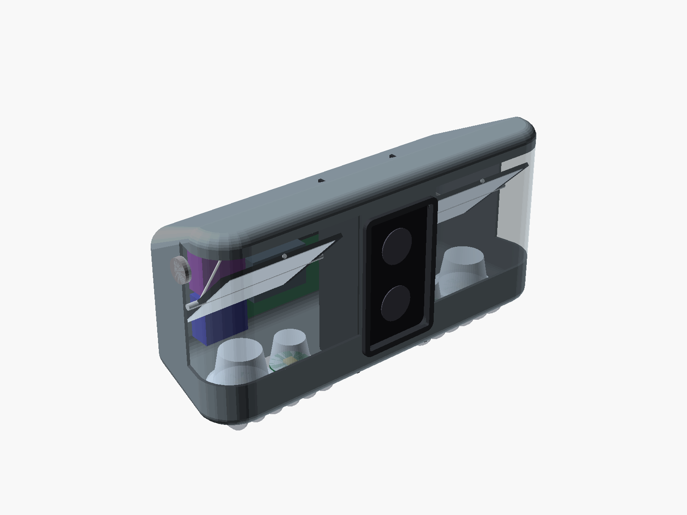

# EUC Stabilized Headlight

An open-hardware, self-levelling headlight for electric unicycles (EUCs).

An EUC pitches nose-down when it accelerates and nose-up when it brakes, by up to about 10°. A fixed headlight swings with it, and when you brake it shines straight into oncoming drivers' eyes. This light keeps its beam level. A small IMU measures pitch, and servos tilt **two lightweight mirrors** that steer the two beams. In a turn, the beam on that side swings into the curve while the other stays straight. The LEDs and heatsinks never move.

**Project site:** [nijaba.github.io/euc-stabilized-headlight](https://nijaba.github.io/euc-stabilized-headlight/): the idea, the ride demo, renders, the anticipated spec and the roadmap on one page.

> **Status: concept design.** Layout v4 was chosen on 2026-11-21. Nothing has been built or tested yet, all figures are estimates, and the design will change, so please don't start building from it. Ideas and doubts are welcome as [issues](https://github.com/nijaba/euc-stabilized-headlight/issues).



**[v4 ride demo](https://nijaba.github.io/euc-stabilized-headlight/v4-ride-demo.html)** ([source](docs/v4-ride-demo.html)): an animated simulation of the firmware's levelling and turn steering. It runs through accelerating, braking, a hill crest and two turns, compared with a fixed light.

## Goals

| Requirement | How it is met |
|---|---|
| Steer the beams with mirrors, not the whole lamp | Two front-surface mirrors at 45°, each on a 2-axis gimbal. Tilting a mirror by θ moves its beam by 2θ, so ±7.5° of mirror covers ±15° of wheel pitch |
| Keep the beam on the road within 1 s | The mirrors cancel accelerating and braking pitch in about 0.05 s. The road-slope estimate settles in under 1 s, without mistaking acceleration for a hill |
| See into turns | The turn-side beam swings up to 25° into the curve, through a clear wraparound side; the other stays straight ahead |
| Fits any EUC, keeps the stock light | 1/4"-20 insert, so GoPro mounts work. Clamp it to the trolley handle or stick it to the shell with curved VHB bases |
| ≥ 2 h runtime | External 20 Ah USB-C PD power bank at 15 V: about 2.4 h in normal mode, about 1.7 h in boost |
| USB-C charging | The power bank charges over USB-C. The head runs on 15 V DC from a PD trigger cable |
| Waterproof | Printed ASA body, two thermoformed polycarbonate sides, O-ring-sealed aluminium heatsink floors, gasketed lidar opening, ePTFE pressure vent, IP68 connector. Nothing moving passes through a wall |
| Mostly off-the-shelf | XIAO ESP32-S3, Adafruit IMU breakout, BuckBlock LED drivers, LEDiL and Carclo optics, hobby servos, GoPro mounts |

## Architecture

```
 Power bank (pouch) ──USB-C PD 15 V──► IP68 2-pin ──► Head
                                                      │
   ┌──────────────────────────────────────────────────┴───────────┐
   │ fuse · reverse-polarity diode · TVS                          │
   │   ├─► BuckBlock #1 ─► 2× XP-L HI   (spots, Carclo 10003)     │
   │   ├─► BuckBlock #2 ─► 2× XP-L HI   (low beams, FILIPPA)      │
   │   └─► 5 V buck ─► 4 servos ─► 2 mirrors (pitch + yaw each)   │
   │                 └─► XIAO ESP32-S3 ◄─I²C─► LSM6DSO32 IMU      │
   │                          ▲   └─I²C─► TF02-Pro lidar          │
   │                          ├── BLE ── wrist remote (nRF52840)  │
   │                          └── Wi-Fi ── calibration page       │
   └──────────────────────────────────────────────────────────────┘
```

Top view of the head (layout v4, front at the top):

```
   ╭── clear side ──┬──────────────┬── clear side ──╮
   │  FILIPPA  spot │  lidar bay   │ spot  FILIPPA  │
   │   ╲ mirror ╱   │  (TF02-Pro)  │   ╲ mirror ╱   │
   │  2 servos      │              │      2 servos  │
   ╰── left module ─┴─ electronics ┴─ right module ─╯
        aluminium heatsink floors, fins fore-aft
                1/4"-20 mount on the back
```

## Key figures (estimates)

| | Normal (1.5 A) | Boost (2.1 A) |
|---|---|---|
| Emitted lumens | ~2400 lm | ~3100 lm |
| Out-the-front lumens (after optics, mirrors, clear sides) | ~1800 lm | ~2400 lm |
| Low beam (cutoff) at 10 m | ~62 lux | ~81 lux |
| Input power | ~21 W | ~30 W |
| Runtime on a 20 Ah bank (~50 Wh usable at 15 V) | ~2.4 h | ~1.7 h |
| Head weight (limit: 400 g with lidar) | ~399 g with lidar (packaging model, measured shell; 1 g of margin, see design §10) | |
| Head size | ~200 × 70 × 111 mm, a rounded light bar | |
| Material cost per unit (limit: $450 with lidar) | ~$440 with the lidar, + power bank (~$342 without the lidar) | |

The low-beam figures were estimated with v3's 4° toe-out; v4 aims both low beams straight ahead outside turns, so the centre should be a little brighter.

## Repository layout

| Path | Contents |
|---|---|
| [`docs/design.md`](docs/design.md) | Full hardware design: optics, mirror mechanism, power, housing, thermal, mounting, electronics, lidar |
| [`docs/firmware-spec.md`](docs/firmware-spec.md) | Firmware behaviour: control loop, calibration, auto-off, thermal derating, BLE remote, lidar fusion, calibration page |
| [`docs/index.html`](docs/index.html) | Project site home page (GitHub Pages, from `docs/`); renders it shows are copied into `docs/img/` by `cad/render.sh` |
| [`docs/v4-ride-demo.html`](docs/v4-ride-demo.html) | Animated simulation of the v4 levelling and turn steering; [open it live](https://nijaba.github.io/euc-stabilized-headlight/v4-ride-demo.html) (GitHub Pages, from `docs/`) |
| [`docs/options-study.md`](docs/options-study.md) | Comparison of beam-shaping and steering alternatives (convex mirror, crossing beams, two 2-axis mirrors, masking, LCD) |
| [`docs/build-plan.md`](docs/build-plan.md) | Phases in order, from bench firmware to ride tests, with checkboxes |
| [`docs/test-plan.md`](docs/test-plan.md) | Every test by ID: automated firmware, bench, enclosure and ride tests |
| [`hardware/BOM.md`](hardware/BOM.md) / [`BOM.csv`](hardware/BOM.csv) | Bill of materials with supplier links, the bench kit and the cost summary |
| [`CHANGELOG.md`](CHANGELOG.md) | Notable changes |
| [`CONTRIBUTING.md`](CONTRIBUTING.md) / [`SECURITY.md`](SECURITY.md) | How to contribute; how to report safety and security faults privately |
| `firmware/` | ESP32-S3 firmware (to do) |
| [`cad/`](cad/) | OpenSCAD packaging models (v4, and v3 as the earlier layout), renders and mass budget |

## Roadmap

The phases and their progress are in [`docs/build-plan.md`](docs/build-plan.md). Next: order the bench kit and start the firmware core (phase 2).

## Safety and legality

- This is an experimental project. Test it carefully, and ride with a backup light until it's proven.
- Lighting rules differ between countries. Aim the low beam so it doesn't dazzle other road users. Self-levelling helps with this, but only if it's calibrated.
- The optional TF02-Pro is a Class 1 (eye-safe) laser device.

## License

GPL-3.0 – see [LICENSE](LICENSE).
