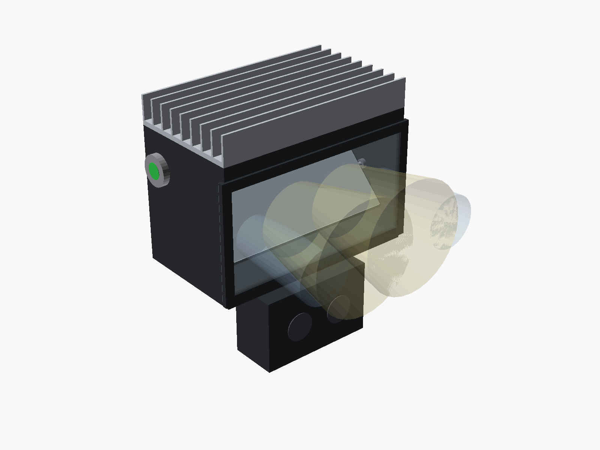

# EUC Stabilized Headlight

An open-hardware, self-levelling headlight for electric unicycles (EUCs).

An EUC pitches nose-down when it accelerates and nose-up when it brakes. A fixed headlight swings with it, and when you brake it shines straight into oncoming drivers' eyes. This light keeps its beam level. A small IMU measures pitch, and a servo tilts a **lightweight mirror** that steers the beam. The LEDs and heatsink never move.

> **Status: design phase.** Nothing has been built or tested yet. All performance figures are estimates.



**[v4 ride demo](https://claude.ai/artifact/W2Fbpx3bwh4NMTwY7sH8hT):** an animated simulation of the firmware's levelling and turn steering for layout v4. It runs through accelerating, braking, a hill crest and two turns, compared with a fixed light.

## Goals

| Requirement | How it is met |
|---|---|
| Steer the beam with a mirror, not the whole lamp | A front-surface mirror at 45° on a balanced pivot. Tilting the mirror by θ moves the beam by 2θ, so ±7.5° of mirror covers ±15° of wheel pitch |
| Fits any EUC, keeps the stock light | 1/4"-20 insert, so GoPro mounts work. Clamp it to the trolley handle or stick it to the shell with curved VHB bases |
| ≥ 2 h runtime | External 20 Ah USB-C PD power bank at 15 V: about 2.4 h in normal mode, about 1.7 h in boost |
| USB-C charging | The power bank charges over USB-C. The head runs on 15 V DC from a PD trigger cable |
| Waterproof | Printed ASA body, O-ring-sealed aluminium heatsink floor, gasketed window, ePTFE pressure vent, IP68 connector |
| Mostly off-the-shelf | XIAO ESP32-S3, Adafruit IMU breakout, BuckBlock LED drivers, Carclo optics, hobby servo, GoPro mounts |

## Architecture

```
 Power bank (pouch) ──USB-C PD 15 V──► IP68 2-pin ──► Head
                                                      │
   ┌──────────────────────────────────────────────────┴───────────┐
   │ fuse · reverse-polarity diode · TVS                          │
   │   ├─► BuckBlock #1 ─► 2× XP-L HI   (spot, Carclo 10003)      │
   │   ├─► BuckBlock #2 ─► 2× XP-L HI   (low, FILIPPA cutoff)     │
   │   ├─► 2× 700 mA ─► cornering lights (IMU-switched, 30° out)  │
   │   └─► 5 V buck ─► servo ─► mirror (4:1 lever)                │
   │                 └─► XIAO ESP32-S3 ◄─I²C─► LSM6DSO32 IMU      │
   │                          ▲   └─I²C─► TF02-Pro lidar (opt.)   │
   │                          └── BLE ── wrist remote (nRF52840)  │
   └──────────────────────────────────────────────────────────────┘
```

Side view of the head (layout v2):

```
   ┌── printed ASA cover (optional lidar pocket on top) ──┐
 ◄─┤   ╱ mirror (balanced pivot)  ── servo + 4:1 pushrod  │ electronics
   │ bezel + window   LEDs + optics ↑                     │ slot
   └── aluminium heatsink floor, fins fore-aft ───────────┘ ← 1/4"-20 mount on the back
```

## Key figures (estimates)

| | Normal (1.5 A) | Boost (2.1 A) |
|---|---|---|
| Emitted lumens | ~2400 lm | ~3100 lm |
| Out-the-front lumens (after optics, mirror, window) | ~1800 lm | ~2400 lm |
| Low beam (cutoff, 4° toe-out) at 10 m | ~62 lux | ~81 lux |
| Input power | ~21 W | ~30 W |
| Runtime on a 20 Ah bank (~50 Wh usable at 15 V) | ~2.4 h | ~1.7 h |
| Head weight (limit: 400 g with lidar) | ~401 g with lidar (packaging study v3, measured shell): at the limit, see design §10 | |
| Head size | ~139 × 70 × 149 mm with brow, tapered and rounded | |
| Material cost per unit (limit: $450 with lidar) | ~$325 + power bank (+ ~$98 lidar) | |

## Repository layout

| Path | Contents |
|---|---|
| [`docs/design.md`](docs/design.md) | Full hardware design: optics, mirror mechanism, power, housing, thermal, mounting, electronics, lidar |
| [`docs/firmware-spec.md`](docs/firmware-spec.md) | Firmware behaviour: control loop, calibration, auto-off, thermal derating, BLE remote, lidar fusion |
| [`docs/options-study.md`](docs/options-study.md) | Comparison of beam-shaping and steering alternatives (convex mirror, crossing beams, two 2-axis mirrors, masking, LCD) |
| [`docs/build-plan.md`](docs/build-plan.md) | Phases in order, from bench firmware to ride tests, with checkboxes |
| [`docs/test-plan.md`](docs/test-plan.md) | Every test by ID: automated firmware, bench, enclosure and ride tests |
| [`hardware/BOM.md`](hardware/BOM.md) / [`BOM.csv`](hardware/BOM.csv) | Bill of materials with supplier links and cost summary |
| [`CHANGELOG.md`](CHANGELOG.md) | Notable changes |
| [`CONTRIBUTING.md`](CONTRIBUTING.md) / [`SECURITY.md`](SECURITY.md) | How to contribute; how to report safety and security faults privately |
| `firmware/` | ESP32-S3 firmware (to do) |
| [`cad/`](cad/) | OpenSCAD packaging model, renders and mass budget |

## Roadmap

The phases and their progress are in [`docs/build-plan.md`](docs/build-plan.md).

## Safety and legality

- This is an experimental project. Test it carefully, and ride with a backup light until it's proven.
- Lighting rules differ between countries. Aim the low beam so it doesn't dazzle other road users. Self-levelling helps with this, but only if it's calibrated.
- The optional TF02-Pro is a Class 1 (eye-safe) laser device.

## License

GPL-3.0 – see [LICENSE](LICENSE).
